# Café com Deploy — Relatório de Voo

 

- [Staging](https://cafe-com-deploy-staging-hkwx.onrender.com/health) · [Versão em staging](https://cafe-com-deploy-staging-hkwx.onrender.com/version)
- [Produção](https://cafe-com-deploy-production.onrender.com/health) · [Versão em produção](https://cafe-com-deploy-production.onrender.com/version) · [Catálogo](https://cafe-com-deploy-production.onrender.com/cafes)
- [Execuções do pipeline](https://github.com/victorcova/cafe-com-deploy-devops-victorcova/actions/workflows/entrega.yml) · [Histórico de rollback](https://github.com/victorcova/cafe-com-deploy-devops-victorcova/actions/workflows/rollback.yml)

Serviços gratuitos podem levar algum tempo para responder após um período de inatividade. Os selos mostram o estado mais recente, que pode mudar.

## 1. Viagem da mudança

```mermaid
flowchart LR
    A[Branch e pull request] --> B[CI: lint, testes, cobertura e auditoria]
    B --> C[Merge na main]
    C --> D[CI reutilizado]
    D --> E[Build único e publicação no GHCR com SHA]
    E --> F[Staging e smoke tests]
    F --> G[Aprovação manual]
    G --> H[Produção com a mesma imagem e smoke tests]
    H -. se necessário .-> I[Rollback manual para imagem estável]
```

O pipeline de entrega é disparado por push na `main`. Ele constrói uma imagem identificada pelo SHA completo do commit e usa essa referência nos dois ambientes. Os smoke tests verificam `/health` e a versão esperada em `/version`. O endpoint `/health` confirma a resposta da aplicação, mas não testa a conexão com o banco; o catálogo `/cafes` permite uma verificação adicional de leitura.

## 2. Diagnóstico dos antipadrões

| Problema do cenário | Prática adotada | Resultado e limite |
| --- | --- | --- |
| Cópia manual por FTP e versão desconhecida | Git, PR, imagem no GHCR e `/version` | O SHA conecta mudança, imagem e aplicação em execução |
| Mudanças sem validação antecipada | CI obrigatório com lint, testes, cobertura e auditoria | O [PR #8](https://github.com/victorcova/cafe-com-deploy-devops-victorcova/pull/8) registrou falha e bloqueio antes da correção |
| Ambiente de teste diferente de produção | Mesma imagem em staging e produção, com bancos e variáveis separados | A paridade da imagem não elimina diferenças de dados e configuração |
| Alteração manual de esquema | Alembic versionado e executado na inicialização | A compatibilidade da aplicação anterior com o esquema deve ser avaliada antes do rollback |
| Dependências sem controle | Versões fixadas, auditoria e Dependabot | O [PR #15](https://github.com/victorcova/cafe-com-deploy-devops-victorcova/pull/15) atualizou SQLAlchemy após CI aprovado |
| Falta de recuperação documentada | Workflow manual de rollback com aprovação e verificação da versão | O exercício restaurou uma imagem anterior compatível com o banco |

A automação reduz etapas manuais, mas não elimina a necessidade de revisar configuração, compatibilidade e resultados. Em um erro de configuração durante o exercício, staging apontou temporariamente para o banco de produção e a migration 003 foi aplicada antes da aprovação de produção. A conexão foi corrigida e os dados foram conferidos. Esse episódio mostra que a separação declarada dos ambientes precisa ser validada também na configuração efetiva.

## 3. Estratégia de testes

A suíte reúne testes unitários da regra de desconto, testes de API e integração com banco. Na execução local inicial registrada no projeto, foram 19 testes aprovados e cobertura de 90,82%; são resultados daquela execução, não uma garantia para versões futuras. O CI exige cobertura mínima de 70%, executa Ruff e `pip-audit` e aplica as migrations em PostgreSQL de teste isolado. O resultado atual pode ser consultado nas execuções do GitHub Actions.

A camada de integração usa um PostgreSQL service container no Actions. Após cada deploy, os smoke tests verificam saúde e versão; eles não substituem testes abrangentes de negócio. No [exercício de regressão](https://github.com/victorcova/cafe-com-deploy-devops-victorcova/pull/8), o primeiro commit falhou no CI; após a correção, o check passou e o PR foi integrado.

## 4. Gerência de dados

1. `001_cria_cafes`: cria a tabela de cafés.
2. `002_cardapio_inicial`: insere o cardápio inicial de cinco cafés.
3. `003_adiciona_origem`: acrescenta a coluna `origem`, não nula, com valor padrão `Nao informada`, preservando os registros anteriores.

A terceira migration representa a fase de expansão: a coluna é adicionada sem remover os campos existentes. O preenchimento de dados específicos e eventual remoção de estruturas antigas exigiriam fases futuras planejadas; não foram realizados aqui. A migration foi criada após o primeiro deploy, mas, pelo erro de configuração descrito acima, sua aplicação no banco de produção ocorreu antes da aprovação esperada. A API atual não expõe a nova coluna.

O rollback demonstrado troca a imagem da aplicação e não desfaz automaticamente migrations. Uma imagem antiga precisa ser compatível com a revisão do banco; o `downgrade` da migration 003 remove a coluna e pode descartar dados, portanto exige avaliação e plano próprios.

## 5. Métricas DORA e evidências

Recorte: execuções do workflow `entrega.yml` concluídas entre 18/10/2026 15h47min e 17h11min, horário de Brasília, consultadas no histórico do GitHub Actions. A amostra é curta e de caráter didático; as métricas não descrevem a maturidade de uma operação contínua.

| Indicador | Resultado observado | Método e limite |
| --- | --- | --- |
| Frequência de deploy | 6 entregas do workflow concluídas com sucesso no recorte | Contagem dos jobs de produção bem-sucedidos nas execuções #1 a #6; não inclui o deploy inicial fora desse workflow nem o rollback |
| Lead time de mudanças | Aproximadamente 9 min em média | Média de 6 intervalos entre a data do commit de merge na `main` e o fim do job de produção: 5min12s, 33min29s, 4min06s, 3min42s, 3min58s e 3min36s; inclui espera por aprovação e não mede o tempo desde o início do desenvolvimento |
| Taxa de falha de mudanças | Não calculada de forma confiável | As 6 execuções concluíram com sucesso, mas esse status, isoladamente, não identifica todos os incidentes ou impactos. A migration aplicada antecipadamente é um desvio real de processo e não deve ser apagada pela contagem de workflows verdes |
| Tempo de recuperação | Rollback de exercício: 4min43s totais; job 53s | Tempo da execução manual até sua conclusão, incluindo espera por aprovação; exercício controlado, sem início de incidente real medido. Não é MTTR de produção |

Evidências: [entrega #1](https://github.com/victorcova/cafe-com-deploy-devops-victorcova/actions/runs/39155403467), [#2](https://github.com/victorcova/cafe-com-deploy-devops-victorcova/actions/runs/39156198189), [#3](https://github.com/victorcova/cafe-com-deploy-devops-victorcova/actions/runs/39159087680), [#4](https://github.com/victorcova/cafe-com-deploy-devops-victorcova/actions/runs/39160870427), [#5](https://github.com/victorcova/cafe-com-deploy-devops-victorcova/actions/runs/39161391282), [#6](https://github.com/victorcova/cafe-com-deploy-devops-victorcova/actions/runs/39161912859) e [rollback](https://github.com/victorcova/cafe-com-deploy-devops-victorcova/actions/runs/39159610879). O rollback restaurou a versão `1ad15c4439df96c3f2e1159452cf0abb40b876d3`, confirmada em `/version`; o catálogo continuou disponível.

## 6. Reflexão sobre implantação contínua

A solução pratica entrega contínua: a mudança é validada e implantada em staging, mas uma pessoa aprova sua promoção para produção. Retirar essa aprovação agora seria prematuro: a amostra é pequena, a verificação de saúde não cobre o banco e houve um erro real de configuração entre ambientes. Antes de considerar implantação contínua, seria necessário fortalecer a validação de isolamento, observabilidade, verificações de negócio e procedimentos de recuperação.

## 7. Integrante e papéis

| Integrante | Matrícula | GitHub | Papéis no trabalho individual |
| --- | --- | --- | --- |
| Victor Cova | 82601067 | [victorcova](https://github.com/victorcova) | Release manager, testes, plataforma, DBA e documentação |

## 8. Conquistas comprovadas

- **Banco de verdade:** PostgreSQL service container na suíte do GitHub Actions, separado dos bancos hospedados.
- As demais conquistas do enunciado não são declaradas concluídas sem evidência completa. Actions fixadas por SHA, por exemplo, não comprovam sozinhas a conquista de cadeia blindada, que também exige SBOM.

## Execução local

Requisitos: Docker e Docker Compose. Clone o repositório e execute `docker compose up --build`; a API ficará em `http://localhost:8000`, com documentação em `/docs`. O Compose usa um PostgreSQL local e dados de exemplo. Para interromper, use `docker compose down`; a remoção do volume de dados é uma operação separada.

A API oferece `GET /health`, `GET /version`, `GET /cafes`, `POST /cafes`, `GET /cafes/{id}` e `GET /cafes/{id}/preco?desconto=10`. O limite de desconto é configurável em `DESCONTO_MAXIMO`. Nunca coloque credenciais reais em `.env.example` ou no repositório.

## Referências

- HUMBLE, Jez; FARLEY, David. *Entrega contínua: como entregar software de forma rápida e confiável*. Porto Alegre: Bookman, 2014.
- FORSGREN, Nicole; HUMBLE, Jez; KIM, Gene. *Accelerate: the science of lean software and DevOps*. Portland: IT Revolution, 2018.
- WIGGINS, Adam. [The Twelve-Factor App](https://12factor.net/pt_br/).
- [GitHub Actions — documentação](https://docs.github.com/pt/actions).
- [DORA — métricas de entrega de software](https://dora.dev/guides/dora-metrics/).
